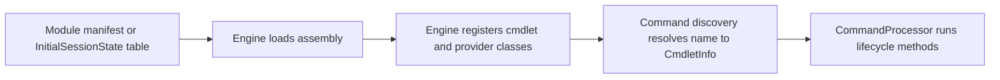

# Command module family: Microsoft.WSMan.Management

> STATIC-ONLY — behavior not run-verified. Inventory is `APPROX` (regex/own-scanner extraction); cmdlets are listed by name and file only (no per-cmdlet walkthroughs, by design).

## 1. Purpose and scope [SPEC]

WS-Management client commands (`Connect-WSMan`, `Get-WSManInstance`, `Invoke-WSManAction`, `Set-WSManQuickConfig`, CredSSP commands, `Test-WSMan`) and the WSMan configuration provider. Windows-targeted; depends on `Microsoft.WSMan.Runtime` for session options.

## 2. Source map

| Path | Type/class | Role | Tier |
|---|---|---|---|
| `src/Microsoft.WSMan.Management/Microsoft.WSMan.Management.csproj` | project | Library, TFM net10.0 | C |
| `src/Microsoft.WSMan.Management/` | 11 C# files, 13139 lines | assembly sources | C |

## 3. Responsibilities and non-responsibilities

Provides the cmdlets/providers inventoried in section 4; contains no language, parser or pipeline logic (those live in `System.Management.Automation`).

## 4. Key types and contracts [IMPL]

**Cmdlet inventory** (<!--N:CMDLET_CLASSES-->300<!--/N--> cmdlet classes in the whole tree; this assembly: 13; `APPROX`, `GENERATED` from `data/cmdlets.json`). Platform-conditional classes are marked by their `#if` condition.

| Cmdlet | Class | File@Line | Parameter sets | ShouldProcess | Dynamic params | Condition |
|---|---|---|---:|---|---|---|
| `Connect-WSMan` | `ConnectWSManCommand` | `src/Microsoft.WSMan.Management/WSManConnections.cs@L127` | 2 |  |  |  |
| `Disable-WSManCredSSP` | `DisableWSManCredSSPCommand` | `src/Microsoft.WSMan.Management/CredSSP.cs@L103` | 0 |  |  |  |
| `Disconnect-WSMan` | `DisconnectWSManCommand` | `src/Microsoft.WSMan.Management/WSManConnections.cs@L304` | 0 |  |  |  |
| `Enable-WSManCredSSP` | `EnableWSManCredSSPCommand` | `src/Microsoft.WSMan.Management/CredSSP.cs@L396` | 0 |  |  |  |
| `Get-WSManCredSSP` | `GetWSManCredSSPCommand` | `src/Microsoft.WSMan.Management/CredSSP.cs@L745` | 0 |  |  |  |
| `Get-WSManInstance` | `GetWSManInstanceCommand` | `src/Microsoft.WSMan.Management/WSManInstance.cs@L33` | 2 |  |  |  |
| `Invoke-WSManAction` | `InvokeWSManActionCommand` | `src/Microsoft.WSMan.Management/InvokeWSManAction.cs@L28` | 2 |  |  |  |
| `New-WSManInstance` | `NewWSManInstanceCommand` | `src/Microsoft.WSMan.Management/WSManInstance.cs@L1330` | 2 |  |  |  |
| `New-WSManSessionOption` | `NewWSManSessionOptionCommand` | `src/Microsoft.WSMan.Management/NewWSManSession.cs@L30` | 0 |  |  |  |
| `Remove-WSManInstance` | `RemoveWSManInstanceCommand` | `src/Microsoft.WSMan.Management/WSManInstance.cs@L1063` | 2 |  |  |  |
| `Set-WSManInstance` | `SetWSManInstanceCommand` | `src/Microsoft.WSMan.Management/WSManInstance.cs@L690` | 2 |  |  |  |
| `Set-WSManQuickConfig` | `SetWSManQuickConfigCommand` | `src/Microsoft.WSMan.Management/Set-QuickConfig.cs@L34` | 0 |  |  |  |
| `Test-WSMan` | `TestWSManCommand` | `src/Microsoft.WSMan.Management/PingWSMan.cs@L27` | 1 |  |  |  |

**Provider inventory**

| Provider | Class | File@Line | Condition |
|---|---|---|---|
| `WSMan` | `WSManConfigProvider` | `src/Microsoft.WSMan.Management/ConfigProvider.cs@L27` |  |

## 5. Data model

Not applicable beyond the cmdlet and provider classes listed above.

## 6. Control flow

The flow is the generic registration path; see [command discovery](../03-runtime/command-discovery-and-invocation.md) and [modules](../03-runtime/modules.md).

## 7. Algorithms

Not applicable: no non-trivial algorithm is documented at family level.

## 8. Observable behavior [SPEC]

Cmdlet behavior is out of scope for this family-level document. No golden sample: STATIC-ONLY.

## 9. Error handling and edge cases

Cmdlets report through the engine's error-record APIs (`WriteError`, `ThrowTerminatingError`), described in [errors-and-diagnostics](../03-runtime/errors-and-diagnostics.md).

## 10. Concurrency and threading

Cmdlets run on the pipeline thread of their runspace; lifecycle overrides per class are in `data/cmdlets.json` (`lifecycle_overrides`). 

## 11. Extension points and customization hooks

### Registration and discovery (`FACT-SRC`)

No module manifest under `src/Modules` loads this assembly by name (registered another way — see annotations).

## 12. Dependencies

Project references: `System.Management.Automation`, `Microsoft.WSMan.Runtime`. Packages: System.Diagnostics.EventLog 10.0.14, System.ServiceProcess.ServiceController 10.0.14. `InternalsVisibleTo` granted by this assembly: none.

## 13. Performance notes

Not applicable at family level.

## 14. Security considerations

No dedicated enforcement point identified at family level (`UNVERIFIED`; Phase 5 enumerates enforcement points across the tree).

## 15. Enterprise considerations

Replaceable surface: a new shell chooses its own cmdlet set; the engine contracts these cmdlets use are the stable part.

## 16. Tests

Pester tests under `test/powershell/Modules` and `test/powershell/engine` exercise these cmdlets (see [REFERENCE-TEST-CORPUS](../02-language/REFERENCE-TEST-CORPUS.md)).

## 17. Design decisions and trade-offs

Not applicable.

## 18. Guidance for the new shell [LESSON]

- **LSN-WSMAN-01** [AVOID] (area: NLD-CMD) Do not carry the WSMan command family into the new shell; remoting transport should be pluggable behind one session abstraction. Evidence: src/Microsoft.WSMan.Management/Microsoft.WSMan.Management.csproj@L11. DEV: DEV-CMD-121

## 19. Open questions / UNVERIFIED items

- `UNVERIFIED`: per-cmdlet behavior (out of scope).

**Shipped type/format XML (project folder):** none in the project folder. **Resource files:** `WsManResources.resx` (64 keys).

Verification: inventory from `data/cmdlets.json` filtered by project (`Microsoft.WSMan.Management`); manifests parsed from `src/Modules/**/*.psd1`; counts reconcile with `numbers.json` key CMDLET_CLASSES for the whole tree.
