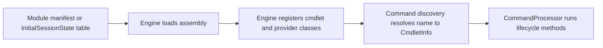

# Command module family: System.Management.Automation

> STATIC-ONLY — behavior not run-verified. Inventory is `APPROX` (regex/own-scanner extraction); cmdlets are listed by name and file only (no per-cmdlet walkthroughs, by design).

## 1. Purpose and scope [SPEC]

The engine assembly itself hosts the commands that implement engine features: command discovery and help (`Get-Command`, `Get-Help`, `Update-Help`, `Save-Help`), modules (`Import-Module`, `Get-Module`, `New-Module`, `New-ModuleManifest`, `Export-ModuleMember`), jobs (`Start-Job`, `Get-Job`, `Receive-Job`, ...), remoting (`Invoke-Command`, `*-PSSession`, `*-PSSessionConfiguration`, `Enable/Disable-PSRemoting`), the pipeline-shaping commands `ForEach-Object` and `Where-Object`, host-output commands (`Out-Default`, `Out-Host`, `Out-Null`, `Format-Default`), history, `Set-StrictMode`, `Set-PSDebug`, `Register-ArgumentCompleter` and experimental-feature commands, plus the six built-in providers (Alias, Environment, FileSystem, Function, Registry (Windows), Variable). Because they live in the engine assembly, these commands can use engine internals directly.

## 2. Source map

| Path | Type/class | Role | Tier |
|---|---|---|---|
| `src/System.Management.Automation/System.Management.Automation.csproj` | project | Library, TFM net10.0 | C |
| `src/System.Management.Automation/` | 704 C# files, 563707 lines | assembly sources | C |

## 3. Responsibilities and non-responsibilities

Engine-integrated commands; unlike the other families, they are not loaded through a module manifest but through built-in registration tables.

## 4. Key types and contracts [IMPL]

**Cmdlet inventory** (<!--N:CMDLET_CLASSES-->300<!--/N--> cmdlet classes in the whole tree; this assembly: 63; `APPROX`, `GENERATED` from `data/cmdlets.json`). Platform-conditional classes are marked by their `#if` condition.

| Cmdlet | Class | File@Line | Parameter sets | ShouldProcess | Dynamic params | Condition |
|---|---|---|---:|---|---|---|
| `Add-History` | `AddHistoryCommand` | `src/System.Management.Automation/engine/hostifaces/History.cs@L1334` | 0 |  |  |  |
| `Clear-History` | `ClearHistoryCommand` | `src/System.Management.Automation/engine/hostifaces/History.cs@L1511` | 2 | yes |  |  |
| `Connect-PSSession` | `ConnectPSSessionCommand` | `src/System.Management.Automation/engine/remoting/commands/ConnectPSSession.cs@L51` | 8 | yes |  |  |
| `Debug-Job` | `DebugJobCommand` | `src/System.Management.Automation/engine/remoting/commands/DebugJob.cs@L29` | 4 | yes |  |  |
| `Disable-ExperimentalFeature` | `DisableExperimentalFeatureCommand` | `src/System.Management.Automation/engine/ExperimentalFeature/EnableDisableExperimentalFeatureCommand.cs@L63` | 0 | yes |  |  |
| `Disable-PSRemoting` | `DisablePSRemotingCommand` | `src/System.Management.Automation/engine/remoting/commands/CustomShellCommands.cs@L5019` | 0 | yes |  |  |
| `Disable-PSSessionConfiguration` | `DisablePSSessionConfigurationCommand` | `src/System.Management.Automation/engine/remoting/commands/CustomShellCommands.cs@L4419` | 0 | yes |  |  |
| `Disconnect-PSSession` | `DisconnectPSSessionCommand` | `src/System.Management.Automation/engine/remoting/commands/DisconnectPSSession.cs@L44` | 4 | yes |  |  |
| `Enable-ExperimentalFeature` | `EnableExperimentalFeatureCommand` | `src/System.Management.Automation/engine/ExperimentalFeature/EnableDisableExperimentalFeatureCommand.cs@L48` | 0 | yes |  |  |
| `Enable-PSRemoting` | `EnablePSRemotingCommand` | `src/System.Management.Automation/engine/remoting/commands/CustomShellCommands.cs@L4651` | 0 | yes |  |  |
| `Enable-PSSessionConfiguration` | `EnablePSSessionConfigurationCommand` | `src/System.Management.Automation/engine/remoting/commands/CustomShellCommands.cs@L3984` | 0 | yes |  |  |
| `Enter-PSHostProcess` | `EnterPSHostProcessCommand` | `src/System.Management.Automation/engine/remoting/commands/EnterPSHostProcessCommand.cs@L30` | 5 |  |  |  |
| `Enter-PSSession` | `EnterPSSessionCommand` | `src/System.Management.Automation/engine/remoting/commands/PushRunspaceCommand.cs@L27` | 17 |  |  |  |
| `Exit-PSHostProcess` | `ExitPSHostProcessCommand` | `src/System.Management.Automation/engine/remoting/commands/EnterPSHostProcessCommand.cs@L443` | 0 |  |  |  |
| `Exit-PSSession` | `ExitPSSessionCommand` | `src/System.Management.Automation/engine/remoting/commands/PopRunspaceCommand.cs@L17` | 0 |  |  |  |
| `Export-ModuleMember` | `ExportModuleMemberCommand` | `src/System.Management.Automation/engine/Modules/ExportModuleMemberCommand.cs@L22` | 0 |  |  |  |
| `ForEach-Object` | `ForEachObjectCommand` | `src/System.Management.Automation/engine/InternalCommands.cs@L65` | 3 | yes |  |  |
| `Format-Default` | `FormatDefaultCommand` | `src/System.Management.Automation/FormatAndOutput/format-default/format-default.cs@L14` | 0 |  |  |  |
| `Get-Command` | `GetCommandCommand` | `src/System.Management.Automation/engine/GetCommandCommand.cs@L29` | 2 |  | yes |  |
| `Get-ExperimentalFeature` | `GetExperimentalFeatureCommand` | `src/System.Management.Automation/engine/ExperimentalFeature/GetExperimentalFeatureCommand.cs@L18` | 0 |  |  |  |
| `Get-Help` | `GetHelpCommand` | `src/System.Management.Automation/help/HelpCommands.cs@L27` | 6 |  |  |  |
| `Get-History` | `GetHistoryCommand` | `src/System.Management.Automation/engine/hostifaces/History.cs@L850` | 0 |  |  |  |
| `Get-Job` | `GetJobCommand` | `src/System.Management.Automation/engine/remoting/commands/GetJob.cs@L16` | 5 |  |  |  |
| `Get-Module` | `GetModuleCommand` | `src/System.Management.Automation/engine/Modules/GetModuleCommand.cs@L33` | 4 |  |  |  |
| `Get-PSHostProcessInfo` | `GetPSHostProcessInfoCommand` | `src/System.Management.Automation/engine/remoting/commands/EnterPSHostProcessCommand.cs@L478` | 3 |  |  |  |
| `Get-PSSession` | `GetPSSessionCommand` | `src/System.Management.Automation/engine/remoting/commands/getrunspacecommand.cs@L48` | 12 |  |  |  |
| `Get-PSSessionCapability` | `GetPSSessionCapabilityCommand` | `src/System.Management.Automation/engine/remoting/commands/CustomShellCommands.cs@L5220` | 0 |  |  |  |
| `Get-PSSessionConfiguration` | `GetPSSessionConfigurationCommand` | `src/System.Management.Automation/engine/remoting/commands/CustomShellCommands.cs@L2709` | 0 |  |  |  |
| `Get-PSSubsystem` | `GetPSSubsystemCommand` | `src/System.Management.Automation/engine/Subsystem/Commands/GetPSSubsystemCommand.cs@L13` | 2 |  |  |  |
| `Import-Module` | `ImportModuleCommand` | `src/System.Management.Automation/engine/Modules/ImportModuleCommand.cs@L44` | 9 |  |  |  |
| `Invoke-Command` | `InvokeCommandCommand` | `src/System.Management.Automation/engine/remoting/commands/InvokeCommandCommand.cs@L128` | 27 |  |  |  |
| `Invoke-History` | `InvokeHistoryCommand` | `src/System.Management.Automation/engine/hostifaces/History.cs@L995` | 0 | yes |  |  |
| `New-Module` | `NewModuleCommand` | `src/System.Management.Automation/engine/Modules/NewModuleCommand.cs@L23` | 2 |  |  |  |
| `New-ModuleManifest` | `NewModuleManifestCommand` | `src/System.Management.Automation/engine/Modules/NewModuleManifestCommand.cs@L30` | 0 | yes |  |  |
| `New-PSRoleCapabilityFile` | `NewPSRoleCapabilityFileCommand` | `src/System.Management.Automation/engine/remoting/commands/NewPSSessionConfigurationFile.cs@L1135` | 0 |  |  |  |
| `New-PSSession` | `NewPSSessionCommand` | `src/System.Management.Automation/engine/remoting/commands/newrunspacecommand.cs@L57` | 11 |  |  |  |
| `New-PSSessionConfigurationFile` | `NewPSSessionConfigurationFileCommand` | `src/System.Management.Automation/engine/remoting/commands/NewPSSessionConfigurationFile.cs@L24` | 0 |  |  |  |
| `New-PSSessionOption` | `NewPSSessionOptionCommand` | `src/System.Management.Automation/engine/remoting/commands/NewPSSessionOptionCommand.cs@L19` | 0 |  |  |  |
| `New-PSTransportOption` | `NewPSTransportOptionCommand` | `src/System.Management.Automation/engine/remoting/commands/NewPSSessionConfigurationOptionCommand.cs@L442` | 0 |  |  |  |
| `Out-Default` | `OutDefaultCommand` | `src/System.Management.Automation/FormatAndOutput/out-console/OutConsole.cs@L44` | 0 |  |  |  |
| `Out-Host` | `OutHostCommand` | `src/System.Management.Automation/FormatAndOutput/out-console/OutConsole.cs@L169` | 0 |  |  |  |
| `Out-LineOutput` | `OutLineOutputCommand` | `src/System.Management.Automation/FormatAndOutput/out-textInterface/OutTextInterface.cs@L18` | 0 |  |  |  |
| `Out-Null` | `OutNullCommand` | `src/System.Management.Automation/FormatAndOutput/out-console/OutConsole.cs@L19` | 0 |  |  |  |
| `Receive-Job` | `ReceiveJobCommand` | `src/System.Management.Automation/engine/remoting/commands/ReceiveJob.cs@L58` | 3 |  |  |  |
| `Receive-PSSession` | `ReceivePSSessionCommand` | `src/System.Management.Automation/engine/remoting/commands/ReceivePSSession.cs@L69` | 8 | yes |  |  |
| `Register-ArgumentCompleter` | `RegisterArgumentCompleterCommand` | `src/System.Management.Automation/engine/CommandCompletion/ExtensibleCompletion.cs@L173` | 3 |  |  |  |
| `Register-PSSessionConfiguration` | `RegisterPSSessionConfigurationCommand` | `src/System.Management.Automation/engine/remoting/commands/CustomShellCommands.cs@L34` | 0 | yes |  |  |
| `Remove-Job` | `RemoveJobCommand` | `src/System.Management.Automation/engine/remoting/commands/RemoveJob.cs@L802` | 5 | yes |  |  |
| `Remove-Module` | `RemoveModuleCommand` | `src/System.Management.Automation/engine/Modules/RemoveModuleCommand.cs@L26` | 3 | yes |  |  |
| `Remove-PSSession` | `RemovePSSessionCommand` | `src/System.Management.Automation/engine/remoting/commands/removerunspacecommand.cs@L35` | 4 | yes |  |  |
| `Save-Help` | `SaveHelpCommand` | `src/System.Management.Automation/help/SaveHelpCommand.cs@L22` | 2 |  |  |  |
| `Set-PSDebug` | `SetPSDebugCommand` | `src/System.Management.Automation/engine/InternalCommands.cs@L2504` | 2 |  |  |  |
| `Set-PSSessionConfiguration` | `SetPSSessionConfigurationCommand` | `src/System.Management.Automation/engine/remoting/commands/CustomShellCommands.cs@L2940` | 0 | yes |  |  |
| `Set-StrictMode` | `SetStrictModeCommand` | `src/System.Management.Automation/engine/InternalCommands.cs@L2630` | 2 |  |  |  |
| `Start-Job` | `StartJobCommand` | `src/System.Management.Automation/engine/remoting/commands/StartJob.cs@L22` | 4 |  |  |  |
| `Stop-Job` | `StopJobCommand` | `src/System.Management.Automation/engine/remoting/commands/StopJob.cs@L21` | 1 | yes |  |  |
| `Switch-Process` | `SwitchProcessCommand` | `src/System.Management.Automation/engine/Modules/SwitchProcessCommand.cs@L22` | 0 |  |  | UNIX |
| `Test-ModuleManifest` | `TestModuleManifestCommand` | `src/System.Management.Automation/engine/Modules/TestModuleManifestCommand.cs@L25` | 0 |  |  |  |
| `Test-PSSessionConfigurationFile` | `TestPSSessionConfigurationFileCommand` | `src/System.Management.Automation/engine/remoting/commands/TestPSSessionConfigurationFile.cs@L21` | 0 |  |  |  |
| `Unregister-PSSessionConfiguration` | `UnregisterPSSessionConfigurationCommand` | `src/System.Management.Automation/engine/remoting/commands/CustomShellCommands.cs@L2473` | 0 | yes |  |  |
| `Update-Help` | `UpdateHelpCommand` | `src/System.Management.Automation/help/UpdateHelpCommand.cs@L23` | 2 | yes |  |  |
| `Wait-Job` | `WaitJobCommand` | `src/System.Management.Automation/engine/remoting/commands/WaitJob.cs@L20` | 1 |  |  |  |
| `Where-Object` | `WhereObjectCommand` | `src/System.Management.Automation/engine/InternalCommands.cs@L1281` | 32 |  |  |  |

**Provider inventory**

| Provider | Class | File@Line | Condition |
|---|---|---|---|
| `Alias` | `AliasProvider` | `src/System.Management.Automation/namespaces/AliasProvider.cs@L24` |  |
| `Environment` | `EnvironmentProvider` | `src/System.Management.Automation/namespaces/EnvironmentProvider.cs@L21` |  |
| `FileSystem` | `FileSystemProvider` | `src/System.Management.Automation/namespaces/FileSystemProvider.cs@L51` |  |
| `Function` | `FunctionProvider` | `src/System.Management.Automation/namespaces/FunctionProvider.cs@L25` |  |
| `Registry` | `RegistryProvider` | `src/System.Management.Automation/namespaces/RegistryProvider.cs@L67` | !UNIX |
| `Variable` | `VariableProvider` | `src/System.Management.Automation/namespaces/VariableProvider.cs@L25` |  |

## 5. Data model

Not applicable beyond the cmdlet and provider classes listed above.

## 6. Control flow

The flow is the generic registration path; see [command discovery](../03-runtime/command-discovery-and-invocation.md) and [modules](../03-runtime/modules.md).

## 7. Algorithms

Not applicable: no non-trivial algorithm is documented at family level.

## 8. Observable behavior [SPEC]

Cmdlet behavior is out of scope for this family-level document. No golden sample: STATIC-ONLY.

## 9. Error handling and edge cases

Cmdlets report through the engine's error-record APIs (`WriteError`, `ThrowTerminatingError`), described in [errors-and-diagnostics](../03-runtime/errors-and-diagnostics.md).

## 10. Concurrency and threading

Cmdlets run on the pipeline thread of their runspace; lifecycle overrides per class are in `data/cmdlets.json` (`lifecycle_overrides`). 

## 11. Extension points and customization hooks

### Registration and discovery (`FACT-SRC`)

62 of the 63 cmdlet classes are registered directly in the engine's built-in tables in `src/System.Management.Automation/engine/InitialSessionState.cs` through `SessionStateCmdletEntry(name, typeof(Class), helpFile)` (first and last entry lines @L5439-L5515).

No module manifest under `src/Modules` loads this assembly by name (registered another way — see annotations).

Providers are declared with `[CmdletProvider(name, capabilities)]`; the built-in set is registered in `InitialSessionState.cs`. See [provider-model](../03-runtime/provider-model.md).

## 12. Dependencies

Project references: `PSVersionInfoGenerator`, `Microsoft.PowerShell.CoreCLR.Eventing`. Packages: Newtonsoft.Json 13.0.4, Microsoft.ApplicationInsights 2.23.0, Microsoft.Win32.Registry.AccessControl 10.0.14, System.CodeDom 10.0.14, System.Configuration.ConfigurationManager 10.0.14, System.Diagnostics.EventLog 10.0.14, System.DirectoryServices 10.0.14, System.Management 10.0.14, System.Security.Cryptography.Pkcs 10.0.14, System.Security.Cryptography.ProtectedData 10.0.14, System.Security.Permissions 10.0.14, Microsoft.Management.Infrastructure 3.0.0, Microsoft.PowerShell.Native 700.0.2, Microsoft.Security.Extensions 1.4.0, System.Windows.Extensions 10.0.14. `InternalsVisibleTo` granted by this assembly: `Microsoft.PowerShell.Commands.Management`, `Microsoft.PowerShell.Commands.Utility`, `Microsoft.PowerShell.ConsoleHost`, `Microsoft.PowerShell.DscSubsystem`, `Microsoft.PowerShell.Security`, `System.Management.Automation.Remoting`, `powershell-perf`, `powershell-tests`.

## 13. Performance notes

Not applicable at family level.

## 14. Security considerations

Several commands are policy-relevant surface rather than ordinary cmdlets: `Invoke-Command`/`*-PSSession`/`*-PSSessionConfiguration` (remoting and JEA configuration), `Import-Module`/`New-ModuleManifest`/`Test-ModuleManifest` (module load trust), `Set-PSDebug`, `Enter-PSHostProcess`. Their enforcement points are catalogued in Phase 5 (`UNVERIFIED` until then).

## 15. Enterprise considerations

The engine-hosted set cannot be trimmed without editing the engine; the registration tables are static. A new shell should make the built-in set data-driven.

## 16. Tests

Pester tests under `test/powershell/Modules` and `test/powershell/engine` exercise these cmdlets (see [REFERENCE-TEST-CORPUS](../02-language/REFERENCE-TEST-CORPUS.md)).

## 17. Design decisions and trade-offs

Putting `ForEach-Object` and `Where-Object` in the engine assembly (rather than the Utility module) keeps the two most-used pipeline commands available in every host and gives them privileged access to the pipeline machinery (`INFERENCE` from their location; `FACT-SRC` for the location).

## 18. Guidance for the new shell [LESSON]

- **LSN-SMACMD-01** [ADAPT] (area: NLD-CMD) Register built-in commands from a declarative table (name -> implementing type -> help) as PowerShell does, but generate the table from attributes at build time so it cannot drift from the classes. Evidence: src/System.Management.Automation/engine/InitialSessionState.cs@L5439.
- **LSN-SMACMD-02** [REPLICATE] (area: NLD-CMD) Keep `ForEach-Object`/`Where-Object` as engine-level commands with direct pipeline access so script-block pipelines do not pay module-load or binding overhead. Evidence: src/System.Management.Automation/engine/InitialSessionState.cs@L5439.

## 19. Open questions / UNVERIFIED items

- `UNVERIFIED`: the exact initial-session-state table boundaries for providers, aliases and variables (only cmdlet entries were extracted).

**Shipped type/format XML (project folder):** none in the project folder. **Resource files:** `Authenticode.resx` (25 keys), `AuthorizationManagerBase.resx` (1 keys), `AutomationExceptions.resx` (30 keys), `CatalogStrings.resx` (16 keys), `CimInstanceTypeAdapterResources.resx` (2 keys), `CmdletizationCoreResources.resx` (15 keys), `CommandBaseStrings.resx` (36 keys), `ConsoleInfoErrorStrings.resx` (11 keys), `CoreClrStubResources.resx` (7 keys), `CredUI.resx` (6 keys), `Credential.resx` (2 keys), `CredentialAttributeStrings.resx` (2 keys), `DebuggerStrings.resx` (47 keys), `DescriptionsStrings.resx` (1 keys), `DiscoveryExceptions.resx` (34 keys), `EnumExpressionEvaluatorStrings.resx` (9 keys), `ErrorCategoryStrings.resx` (33 keys), `ErrorPackage.resx` (6 keys), `EtwLoggingStrings.resx` (35 keys), `EventResource.resx` (190 keys), `EventingResources.resx` (7 keys), `ExperimentalFeatureStrings.resx` (2 keys), `ExtendedTypeSystem.resx` (94 keys), `FileSystemProviderStrings.resx` (82 keys), `FormatAndOutXmlLoadingStrings.resx` (68 keys), `FormatAndOut_MshParameter.resx` (19 keys), `FormatAndOut_format_xxx.resx` (20 keys), `FormatAndOut_out_xxx.resx` (6 keys), `GetErrorText.resx` (9 keys), `HelpDisplayStrings.resx` (114 keys), `HelpErrors.resx` (25 keys), `HistoryStrings.resx` (11 keys), `HostInterfaceExceptionsStrings.resx` (4 keys), `InternalCommandStrings.resx` (24 keys), `InternalHostStrings.resx` (1 keys), `InternalHostUserInterfaceStrings.resx` (29 keys), `Logging.resx` (11 keys), `Metadata.resx` (49 keys), `MiniShellErrors.resx` (2 keys), `Modules.resx` (187 keys), `MshHostRawUserInterfaceStrings.resx` (3 keys), `MshSignature.resx` (8 keys), `MshSnapInCmdletResources.resx` (4 keys), `MshSnapinInfo.resx` (13 keys), `NativeCP.resx` (9 keys), `PSCommandStrings.resx` (1 keys), `PSConfigurationStrings.resx` (3 keys), `PSDataBufferStrings.resx` (5 keys), `PSListModifierStrings.resx` (2 keys), `PSStyleStrings.resx` (3 keys), `ParameterBinderStrings.resx` (47 keys), `ParserStrings.resx` (412 keys), `PathUtilsStrings.resx` (10 keys), `PipelineStrings.resx` (19 keys), `PowerShellStrings.resx` (20 keys), `ProgressRecordStrings.resx` (4 keys), `ProviderBaseSecurity.resx` (1 keys), `ProxyCommandStrings.resx` (2 keys), `RegistryProviderStrings.resx` (71 keys), `RemotingErrorIdStrings.resx` (524 keys), `RunspaceInit.resx` (36 keys), `RunspacePoolStrings.resx` (15 keys), `RunspaceStrings.resx` (40 keys), `SecuritySupportStrings.resx` (16 keys), `Serialization.resx` (25 keys), `SessionStateProviderBaseStrings.resx` (12 keys), `SessionStateStrings.resx` (179 keys), `StringDecoratedStrings.resx` (1 keys), `SubsystemStrings.resx` (13 keys), `SuggestionStrings.resx` (2 keys), `TabCompletionStrings.resx` (129 keys), `TransactionStrings.resx` (18 keys), `TypesXmlStrings.resx` (45 keys), `VerbDescriptionStrings.resx` (100 keys), `WildcardPatternStrings.resx` (1 keys).

Verification: inventory from `data/cmdlets.json` filtered by project (`System.Management.Automation`); manifests parsed from `src/Modules/**/*.psd1`; counts reconcile with `numbers.json` key CMDLET_CLASSES for the whole tree.
